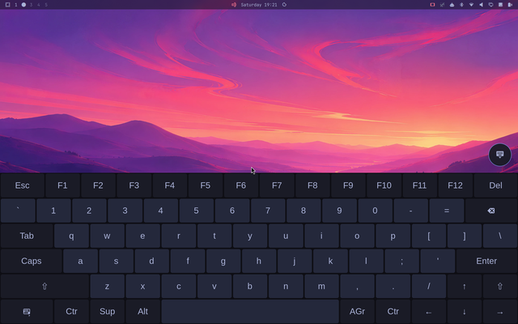
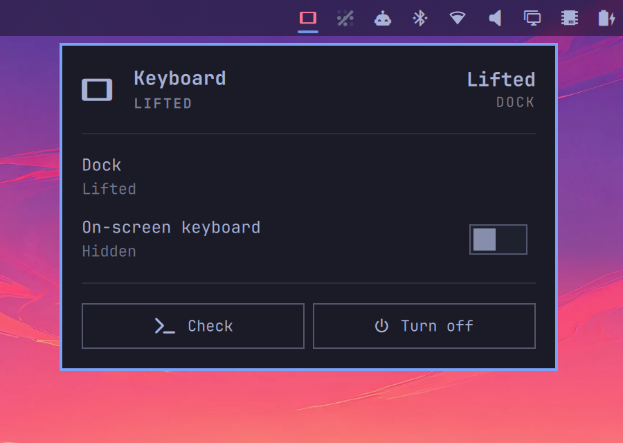

# Zephyrus Duo Keyboard for Omarchy

An Omarchy bar widget and a user service that show the on-screen keyboard on the bottom panel of an ASUS ROG Zephyrus Duo GX651AX. Seating the magnetic keyboard hides it. Lifting the keyboard leaves it hidden, unless you turn on `show_keyboard`.

**Screen rotation is `zephyrus-duo-rotate`, not this plugin.** This plugin does not turn either panel, map touch, change window gaps, or claim the accelerometer. `zephyrus-duo-dock` is what powers the bottom panel off when the keyboard is seated.

<p align="center">
  
</p>

Forked from [Alan Roman's ROG Flow Z13 plugin](https://github.com/AlanRoman117/omarchy-tablet-mode-asus-rog-flow-z13). The plugin id, command, and user service are different, so the two can be installed side by side. Tested on one machine: GX651AX (2026), Omarchy 4.0.0, Hyprland 0.57.0.

## What it does

Docked means USB product `1ce6` is on the bus (`0b05:1ce6`), the same test as `zephyrus-duo-dock`. That is the magnetic keyboard seated on the bottom panel. Lifted, that id is absent and the keyboard is Bluetooth instead.

| | Keyboard lifted | Keyboard seated (`0b05:1ce6`) |
|---|---|---|
| On-screen keyboard | Left as it is. Shown only if `show_keyboard=true` | Hidden |
| Where it is drawn | Bottom connector from `zephyrus-duo-panels`, or the top connector if `bottom` is empty | Hidden |
| Bottom panel power | Unchanged | Unchanged. `zephyrus-duo-dock` turns it off |
| Screen rotation | `zephyrus-duo-rotate` | `zephyrus-duo-rotate` |

`zephyrus-duo-keyboard on`, `off`, and `osk show|hide|toggle` change visibility until the next time `0b05:1ce6` appears, which hides the keyboard. They do not rotate anything.

A dock, a lift, or a rotation while the keyboard is lifted runs `hyprctl reload` from the other Duo scripts. If the on-screen keyboard was visible, this plugin shows it again on the current bottom connector. It writes no layout rules.

A round keyboard button floats on both internal screens, and only while the magnetic keyboard is lifted and this service is running.

## Requirements

- Omarchy 4 (Hyprland).
- `zephyrus-duo-panels` and `zephyrus-duo-rotate` on `PATH`. The rotator should already be running. This plugin checks both with `doctor` and does not start the rotator.
- `wvkbd-deskus` with `--output`. It is often already installed. `zephyrus-duo-keyboard install` rebuilds it from `packaging/wvkbd-deskus` when it is missing or older than this recipe.
- `jq`, `socat`, and `python3` (to edit the menu file safely). `base-devel` is needed only to build the keyboard.

## Install

```bash
omarchy plugin add https://github.com/brogers/omarchy-tablet-mode-zephyrus-duo.git
zephyrus-duo-keyboard install    # no-op when wvkbd-deskus is already current
zephyrus-duo-keyboard enable
```

`install` prints every file of `packaging/wvkbd-deskus` and asks before building, even with `--yes`. The recipe is wvkbd 0.20 from upstream plus three patches: a US desktop layout, held keys that stay down until the finger lifts, and `--output` so the keyboard stays on one connector. makepkg checks the upstream source against its pinned checksum.

`enable` writes `~/.config/omarchy/zephyrus-duo-keyboard.conf`, starts `zephyrus-duo-keyboard.service`, adds the menu entries, installs a theme hook, and links `~/.local/bin/zephyrus-duo-keyboard`.

## The card



Tap the bar icon:

- **Dock**: seated or lifted.
- **On-screen keyboard** switch.
- **Check** (runs `doctor`) and **Turn off**.

Before the service is running, the card offers **Set up**, **Finish setup**, **Start**, or **Turn on**, plus **Check**.

The same controls are in the Omarchy menu under **Trigger → Toggle**: **On-screen Keyboard**, and **Zephyrus Duo Keyboard** to turn the plugin on or off.

The floating button uses the layer namespace `zephyrus-duo-keyboard-button`. It is on each `eDP` bar only while the daemon is running and the keyboard is lifted.

## Commands

```bash
zephyrus-duo-keyboard status            # dock, pinned output, whether the keyboard is shown
zephyrus-duo-keyboard status --json
zephyrus-duo-keyboard on|off|toggle     # until 0b05:1ce6 next appears, which hides it
zephyrus-duo-keyboard osk show|hide|toggle
zephyrus-duo-keyboard doctor            # wvkbd, panels, the rotator, and the dock id
```

`rotate`, `lock`, and `calibrate` are refused. The message names `zephyrus-duo-rotate`.

## Turning it off

```bash
zephyrus-duo-keyboard disable           # stop the service and wvkbd; the bar icon stays
zephyrus-duo-keyboard disable --full    # also remove the menu entries, the theme hook, and the bar icon
zephyrus-duo-keyboard enable            # bring it back
```

`disable` does not move the panels or change gaps. Stopping the service runs `restore`, which hides and stops `wvkbd` only.

`zephyrus-duo-keyboard uninstall` is `disable --full` plus removal of the unit file and the `~/.local/bin` link. `--packages` can also remove `wvkbd-deskus`. The plugin files stay until:

```bash
omarchy plugin remove brogers.zephyrus-duo-keyboard
```

## Settings

`~/.config/omarchy/zephyrus-duo-keyboard.conf`, written by `enable`:

```
enabled=true
keyboard=0b05:1ce6
auto_rotate=false
show_keyboard=false
touch_tweaks=false
```

| Key | Default | |
|---|---|---|
| `enabled` | `true` | `false` means the service exits and nothing starts at login |
| `keyboard` | `0b05:1ce6` | USB id that means seated. Present hides the on-screen keyboard |
| `show_keyboard` | `false` | `true` shows the on-screen keyboard on every lift. Leave this off when another keyboard is in use |
| `auto_rotate` | `false` | Ignored. Rotation is `zephyrus-duo-rotate` |
| `touch_tweaks` | `false` | Ignored. This plugin does not change gaps |

`keyboard=0b05:1ce6` means the magnetic keyboard is seated on the bottom panel. It does not mean "detached, so enter tablet mode."

Optional keys the daemon still reads if you add them: `notify` (`true`), `resume_delay_ms` (`2000`), `osk` (`auto`, or `wvkbd-deskus`), `osk_height_landscape` and `osk_height_portrait` (`420`). After editing, run `systemctl --user restart zephyrus-duo-keyboard`.

Before sleep the service hides the on-screen keyboard. It does not take a logind sleep delay lock. About two seconds after resume it shows the keyboard again only if it was visible and the keyboard is still lifted.

## How it works

`zephyrus-duo-keyboard daemon` runs as the `zephyrus-duo-keyboard` user service. It handles one event at a time from a FIFO, fed by three readers:

- `udevadm monitor` for USB add and remove. After the bus has been quiet, a seated `0b05:1ce6` hides `wvkbd`. A lift follows `show_keyboard` only.
- Hyprland's event socket for `configreloaded`. A visible keyboard is shown again on the connector `zephyrus-duo-panels` names. Nothing else runs.
- `gdbus monitor` on logind's `PrepareForSleep`, to hide the keyboard across suspend. There is no inhibitor.

`wvkbd-deskus --output` is pinned to `bottom` from `eval "$(zephyrus-duo-panels)"`, or to `top` when `bottom` is empty (booted while docked, so the bottom panel was never detected). A name that is not a connector token is refused.

State goes to `$XDG_RUNTIME_DIR/zephyrus-duo-keyboard/state.json`, which the card watches. `status --json` includes `dock` (`seated` or `lifted`) and `osk_output`.

`doctor` checks that `wvkbd-deskus` is installed, `zephyrus-duo-panels` returns a top panel, `zephyrus-duo-rotate` is running, this process has no `monitor-sensor` child, and `keyboard` is `0b05:1ce6`. It prints seated or lifted, and the output it would pin to.

## Good to know

- The on-screen keyboard does not appear when you tap a text field. Show it from the card, the menu, the floating button, or `zephyrus-duo-keyboard osk show`.
- The layout is a US desktop keyboard. A held key stays down until you lift your finger. The theme hook restyles it when the Omarchy theme changes.
- Typing on it into the Omarchy menu or a bar popup closes them. That is an Omarchy bug ([omacom/omarchy#9029](https://github.com/omacom/omarchy/issues/9029), [#9756](https://github.com/omacom/omarchy/issues/9756)). Normal app windows are fine.
- If `zephyrus-duo-panels` names the wrong connector after a GPU mux change, the keyboard follows the wrong panel. `doctor` prints the names it resolved.

## Licence

- **The plugin**, including the PKGBUILD in `packaging/wvkbd-deskus/`: MIT, see `LICENSE`. Copyright (c) 2026 Alan Roman. This fork keeps that notice.
- **The three `.patch` files in `packaging/wvkbd-deskus/`:** GPL-3.0-only. They modify [wvkbd](https://git.sr.ht/~proycon/wvkbd), which upstream's COPYING puts under the GPL v3.0, so they're under it too; each carries an SPDX header.
- **The built package** is wvkbd itself: GPL-3.0-only, plus MIT for upstream's `os-compatibility.c` (from Weston). It installs upstream's `LICENSE`, `COPYING` and `COPYING_WESTON`. The PKGBUILD downloads wvkbd's source from upstream; none of it is copied into this repo.
